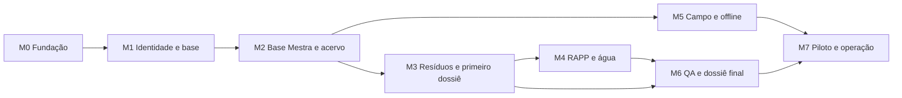

# Roadmap e milestones

Outcome-based plan without invented dates or estimates. Native milestones M0–M7 already exist and their issue associations were verified on 2026-10-20. Due dates remain empty until capacity and availability are agreed. Project configuration and main protection are verified in [the GOV-02 record](github-project.md#verified-configuration--2026-10-20); that administrative completion does not satisfy the product exit gates below.

| Fase | Entrega | Gate de saída |
|---|---|---|
| M0 | Fundação e governança | Manual, decisões, roadmap e fluxo de contribuição revisados. |
| M1 | Base executável e identidade | App local, CI, autenticação, MFA e isolamento verificados com dados sintéticos. |
| M2 | Base Mestra e acervo | Empresa/unidade, documentos versionados e processos com rastreabilidade. |
| M3 | Primeiro fluxo completo de resíduos | Inventário demonstrável da fonte ao dossiê preliminar; piloto sempre sintético até M7. |
| M4 | RAPP e recursos hídricos | Memórias, regras versionadas e cruzamento de evidências revisados pela responsável técnica. |
| M5 | Campo e sincronização | Captura móvel e recuperação offline verificadas em dispositivos reais. |
| M6 | Revisão e dossiê final | QA-A a QA-G, manifest íntegro, protocolos e recibos com histórico. |
| M7 | Piloto e operação | Restauração testada, uso permitido pelo plano, aceite da usuária e operação documentada. |

## Dependências e entregas

M5 pode começar depois de M2 sem aguardar todos os módulos de M4, respeitando as dependências de cada issue. Segurança, acessibilidade e integridade acompanham todas as fases; M7 verifica o conjunto.

## Próximas entregas concretas

1. Obtain the environmental professional’s review and accepted scope (#1). The foundation PRs are merged.
2. Confirm professional-use hosting eligibility and the operating budget (#3). Project setup and main protection (#2) are configured; do not recreate them.
3. Complete remaining UX/accessibility (#5) and authentication recovery/MFA (#6). The executable foundation (#4) and database nucleus (#7) were closed by #27; #28 supplies fresh-stack correction and verification.
4. Continue master data, private evidence storage and the remaining process modules in [backlog dependency order](backlog.md).

## Regras de priorização

P0: bloqueia integridade, entrega da fase ou liberação. P1: necessário para a versão operacional, mas pode seguir a base. P2: evolução. Prioridade é relativa à fase; um P0 de M7 não exige construir o dossiê antes do cadastro.

O primeiro fluxo demonstrável (M3) utiliza dados sintéticos. A primeira versão operacional exige os gates M7. Mudanças de escopo ajustam issues e ADRs antes de reestimar.

## Milestones nativos

Para cada fase: título “M0 — Fundação e governança” (e equivalentes), descrição igual ao gate acima, sem due date até haver compromisso. Vincular cada issue conforme backlog.json; não recriar milestone homônimo. Fechar milestone somente após verificar critérios, não apenas pela contagem de issues fechadas.
